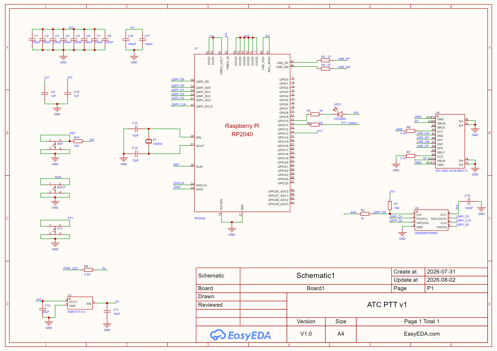

# ATC USB PTT (SharkLite)

A plug-and-play **USB push-to-talk button** for virtual Air Traffic Controllers and handheld-radio operators.

It works on any computer with no drivers. Press the button and your radio or voice client transmits; release it and it stops. The PTT button can act as a **keyboard key** or as a **joystick button**, and you change it from the SharkLite Configurator app.

[](https://github.com/AviatorRoyal/ATC-USB-PTT/releases/latest)

---

## Features

- **Two output modes**
  - **Keyboard**: sends a key of your choice (Left/Right Ctrl, Shift, Alt, F13, F14, A, B).
  - **Joystick** *(new in v1.2)*: shows up as a game controller and sends joystick button 1-32. It doesn't clash with typing, and apps that support joystick PTT can use it.
- **Instant switching**: changing the key, button or mode takes effect right away, with no reboot.
- **Saved on the device**: settings are kept in flash, so the button works the same on any PC.
- **RGB status LED** with adjustable brightness.
- **No drivers needed**: a standard USB HID device on Windows, macOS and Linux. The Configurator app is for Windows.
- **One-click firmware updates**: the Configurator flashes a `.uf2` for you, with no BOOT button needed. Drag and drop also works.

## Download

Get the latest files from the **[Releases page](https://github.com/AviatorRoyal/ATC-USB-PTT/releases/latest)**:

| File | What it is |
|---|---|
| `SharkLite-PTT-vX.Y.Z.uf2` | Firmware for the device |
| `SharkLite-Configurator-vX.Y.Z.zip` | Windows configuration app |

## Getting started

### 1. Flash the firmware

**With the Configurator (recommended)**

1. Unzip and run **SharkLite Configurator.exe**, then click **Update Firmware**.
2. Select the `.uf2` file and confirm.
3. The app restarts the device into its bootloader, copies the firmware and waits for the device to come back. You don't need to press any button.

If the board is blank or not responding, click **Update Firmware** anyway. When asked, hold the **BOOT** button while plugging it in.

**Manually (drag and drop)**

1. Hold the **BOOT** button while plugging in the USB cable. A drive named **`RPI-RP2`** appears.
2. Drag the `.uf2` file onto it. The board reboots by itself, and the LED flashes red, green, then blue.

### 2. Configure it

1. Run **SharkLite Configurator.exe**. It finds the device automatically.
2. Pick an **Output** mode:
   - **Keyboard**: choose the PTT key.
   - **Joystick**: choose the joystick button number (1-32).
3. Set the LED brightness if you want.
4. Click **Save**.

The **Button** field shows *Pressed* or *Released* live, so you can test the button.

### 3. Bind it in your app

In your voice or radio client (e.g. TrackAudio, vPilot, Discord, TeamSpeak), open the PTT key binding and press the button. Depending on the mode, the app sees either the key you chose or *Joystick Button N*.

## Status LED

| Colour | Meaning |
|---|---|
| 🟢 Green | Running, ready |
| 🔵 Blue | PTT button held |
| 🔴 Red | Configurator connected |

## Hardware

The firmware targets the **Waveshare RP2040-Zero**:

| Function | Pin |
|---|---|
| PTT button (to GND, internal pull-up) | GPIO13 |
| WS2812 RGB status LED (on board) | GPIO16 |

The [`Hardware`](Hardware) folder has the custom **ATC PTT v1** PCB design: a bare RP2040 with USB-C, W25Q80 flash and AMS1117-3.3 regulator. It includes:

- EasyEDA Pro project: [`Hardware/epro`](Hardware/epro)
- Gerbers ready to order: [`Hardware/gerber/PCB_PTT.zip`](Hardware/gerber/PCB_PTT.zip)
- Schematic, shown below



## Notes

- **USB ID changed in v1.2.** The device now reports VID `0x2E8A` / PID `0x8103` (v1.0.x: `0x8003`) because it now includes a joystick. Use the v1.2 Configurator or newer; older ones won't find the device.
- **Game controller listing.** From v1.2 the device always appears under Windows *Game Controllers* (`joy.cpl`), even in Keyboard mode. That's expected.
- **Device not detected after an update.** If Windows still shows the old device after a firmware update, unplug it and plug it back in.

---

## For developers

### Repository layout

```
Dashboard/   SharkLite Configurator (Python + Tkinter)
Firmware/    Arduino firmware (ptt/ptt.ino) and release .uf2 files
Hardware/    EasyEDA project, Gerbers and schematic
```

### Building the firmware

- **Arduino IDE**: install the [arduino-pico](https://github.com/earlephilhower/arduino-pico) core and the **Adafruit NeoPixel** library. Select the board **Waveshare RP2040 Zero** and keep the default USB stack (Pico SDK).
- **arduino-cli**:

```bash
arduino-cli compile --fqbn rp2040:rp2040:waveshare_rp2040_zero --output-dir build Firmware/ptt
```

### Running and packaging the Configurator

```bash
pip install pyserial pyinstaller
```

```bash
python Dashboard/main.py
```

To build the `.exe`, run this from the `Dashboard` folder:

```bash
pyinstaller "SharkLite Configurator.spec"
```

### Serial protocol

The Configurator talks to the device over USB serial at 115200 baud, one command per line:

| Command | Reply | Purpose |
|---|---|---|
| `GETINFO` | `READY`, `VERSION:`, `KEY:`, `BRIGHTNESS:`, `MODE:`, `JOYBTN:`, `BTN:` | Read everything |
| `SETKEY:<0-9>` | `OK` / `ERROR` | Keyboard key |
| `SETMODE:<0\|1>` | `OK` / `ERROR` | 0 = Keyboard, 1 = Joystick |
| `SETJOYBTN:<1-32>` | `OK` / `ERROR` | Joystick button |
| `SETBRIGHTNESS:<0-100>` | `OK` / `ERROR` | LED brightness (%) |
| `SAVE` | `OK` | Store settings in flash |
| `FACTORYRESET` | `OK` | Restore defaults |
| `RESET` / `BOOTSEL` | `OK` | Reboot / enter bootloader |
| `PING` | `PONG` | Connection check |

The device also sends `BTN:1` / `BTN:0` whenever the PTT button changes state.
